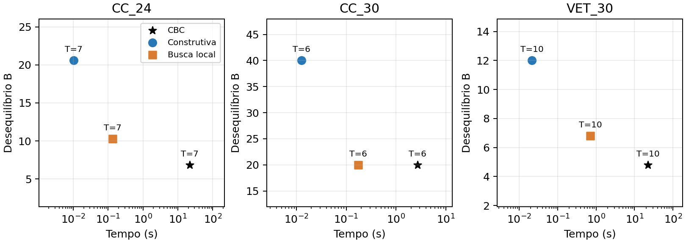

# Planejamento curricular em Jupyter - fases 2 e 3

## 1. Problema e dados

Planejamento curricular individual - GCC118 / Programação Matemática / UFLA / 2026/2. Aluno: Caio Teixeira Ladeira. Fases 2 e 3: formulação exata, testes no solver e métodos heurísticos, com execução em Jupyter.

O problema consiste em distribuir as disciplinas restantes entre períodos letivos. Há dois objetivos em ordem de prioridade: concluir o curso no menor número de períodos e, mantendo essa duração, equilibrar os créditos. Um plano só é aceito se respeitar os requisitos de matrícula considerados no modelo.

### Dados públicos e perfis experimentais

| Curso e matriz | Selecionados | Aprovados | Pendentes | Créditos pendentes |
| --- | --- | --- | --- | --- |
| Computação 2023/1 | 47 | 3 | 44 | 156 |
| Veterinária 2022/2 | 63 | 0 | 63 | 282 |

As disciplinas e os requisitos foram transcritos das matrizes públicas do SIG/UFLA, identificadas como 313 e 302. Os dados estão em dois CSV, com código, nome, créditos, carga horária, módulo, pré-requisitos, correquisitos e percentual mínimo. Os requisitos de Computação incorporam a revisão do SIG feita em 06/11/2026.

O histórico de Computação considera GAC124, GAC108 e GCC218 aprovadas. As eletivas já foram escolhidas: o modelo organiza o conjunto selecionado, sem decidir quais eletivas cursar. O histórico, essa seleção e os limites de créditos são escolhas experimentais.

### Hipóteses

Cada componente futuro é considerado aprovado ao final do período. Por isso, pré-requisitos fortes e mínimos são representados como aprovação anterior. Um correquisito pode ter sido aprovado antes ou ser cursado junto; relações recíprocas obrigam simultaneidade. Não são modeladas oferta de turmas, horários, vagas, equivalências e reprovações futuras.

Créditos e carga horária são medidas distintas. Em Computação, cada TCC tem zero créditos, mas 170 horas-aula. A carga é armazenada em unidades de 10 minutos: 85 unidades por crédito regular e 850 por TCC. O total fixo do curso é 16.968 unidades (2.828 horas-relógio), incluindo 108 horas complementares. O histórico experimental não possui horas complementares aprovadas.

Ética exige 60% do curso concluído, e os TCCs exigem 65%. Os limiares são arredondados para cima: 10.181 e 11.030 unidades, respectivamente. Apenas a carga aprovada antes do período pode liberar esses componentes.

## 2. Formulação exata

Seja D o conjunto de disciplinas pendentes e t = 1,...,H o conjunto de períodos disponíveis. A carga em créditos de i é c[i]; U é o limite por período. P[i] contém os pré-requisitos pendentes e R[i] os correquisitos pendentes. Requisitos já aprovados não precisam de novas variáveis.

| Variável | Domínio | Significado |
| --- | --- | --- |
| x[i,t] | Binária | 1 se i é cursada no período t |
| y[t] | Binária | 1 se o período t é usado |
| d[t] | Contínua, >= 0 | Desvio absoluto de créditos na segunda etapa |

### Primeira etapa: menor duração

```text
Minimizar T = soma_t y[t]
```

Cada disciplina deve aparecer exatamente uma vez, e a soma dos créditos do período deve respeitar a capacidade:

```text
soma_t x[i,t] = 1                         para cada i
```

```text
soma_i c[i] x[i,t] <= U                   para cada t
```

As três relações abaixo associam as disciplinas aos períodos usados e impedem lacunas entre períodos. Assim, contar os períodos usados equivale a medir a duração até a conclusão:

```text
x[i,t] <= y[t]                           para cada i,t
```

```text
y[t] <= soma_i x[i,t]                     para cada t
```

```text
y[t+1] <= y[t]                           para t < H
```

### Requisitos temporais

Se p é pré-requisito de i, precisa aparecer em um período anterior. Se q é correquisito de i, pode aparecer antes ou no mesmo período:

```text
x[i,t] <= soma_{s<t} x[p,s]               para p em P[i]
```

```text
x[i,t] <= soma_{s<=t} x[q,s]              para q em R[i]
```

As duas desigualdades são aplicadas para cada período t. Uma soma vazia vale zero. Se x[i,t]=1, a atribuição única obriga o requisito a ter sido alocado no intervalo permitido.

## 3. Percentuais e equilíbrio

### Percentual concluído antes da matrícula

Seja w[j] a carga horária de j em unidades de 10 minutos; A0 é a carga já aprovada no histórico. W é o total fixo do curso e p[i] é o percentual exigido. Define-se q[i] = teto(W p[i]/100), calculado nos dados.

```text
soma_j soma_{s<t} w[j] x[j,s] >= max(0, q[i]-A0) x[i,t]
```

A desigualdade é aplicada às disciplinas com percentual mínimo. Quando x[i,t]=1, a carga anterior deve cobrir o que falta ao histórico. Componentes do próprio período não entram na soma. Quando o histórico já satisfaz o limiar, o lado direito é zero.

### Segunda etapa: distribuir os créditos

A segunda chamada só é executada se o CBC provar T* na primeira. Reconstrói-se o modelo com os períodos 1,...,T*, mantendo atribuição, capacidade e requisitos. Cada período deve conter ao menos uma disciplina. As variáveis y deixam de ser necessárias.

```text
soma_i x[i,t] >= 1                       para t = 1,...,T*
```

```text
C[t] = soma_i c[i] x[i,t]
```

```text
media = soma_i c[i] / T*
```

```text
d[t] >= C[t] - media
```

```text
d[t] >= media - C[t]
```

```text
Minimizar B = soma_t d[t]
```

Na solução ótima, d[t] é o valor absoluto da diferença entre a carga do período e a média. Essa linearização mantém o problema como PLIM. Um B menor indica mais equilíbrio, mas só deve ser comparado depois do número de períodos: T tem prioridade.

### Tamanho e implementação

A primeira etapa possui nH+H variáveis binárias, sendo n o número de disciplinas pendentes. A segunda possui nT* binárias e T* contínuas. O número de restrições depende das relações curriculares e dos percentuais. As dimensões efetivamente construídas, antes do presolve, estão na tabela de resultados.

A implementação está na seção 3 do notebook, nas funções montar_modelo e resolver_exato. O plano final também é conferido diretamente pelos dados, sem depender das variáveis e restrições do solver. Se uma chamada para por tempo, seu status é preservado. Um plano válido não é automaticamente uma prova de ótimo.

## 4. Heurísticas e experimentos

### Construção gulosa

O algoritmo monta um período de cada vez. Prioriza disciplinas que liberam cadeias mais longas de pré-requisitos; em empate, prioriza maior carga horária e depois o código. Para incluir uma disciplina, reúne seus correquisitos ainda pendentes em um pacote. O pacote só entra se os pré-requisitos e percentuais estiverem satisfeitos antes do período e se seus créditos couberem na capacidade.

Ao encerrar um período, seus componentes passam a integrar as aprovações para o próximo. Se não houver pacote elegível ou o horizonte acabar, a construção retorna sem plano. Isso é uma falha da heurística, não uma prova de inviabilidade.

### Busca local

A busca parte do plano guloso e tenta duas vizinhanças: realocar uma disciplina para outro período e trocar os períodos de duas disciplinas. Aceita a primeira melhora viável em (T,B), reinicia a procura e termina quando não existe melhora nessas vizinhanças. O validador confere todos os requisitos a cada movimento aceito. A busca é determinística e não consulta respostas do solver.

### Cenários

| Cenário | Pendentes | Créditos | U | H |
| --- | --- | --- | --- | --- |
| SINT_8 | 8 | 30 | 16 | 4 |
| SINT_16 | 16 | 62 | 16 | 6 |
| SINT_24 | 24 | 96 | 16 | 8 |
| CC_18 | 44 | 156 | 18 | 12 |
| CC_24 | 44 | 156 | 24 | 10 |
| CC_30 | 44 | 156 | 30 | 10 |
| CC_AVANCADO | 35 | 124 | 24 | 10 |
| CC_PRAZO_6 | 44 | 156 | 24 | 6 |
| VET_30 | 63 | 282 | 30 | 12 |

Os sintéticos são gerados com 8, 16 e 24 disciplinas, quatro cadeias de pré-requisitos e créditos alternando 2, 4 e 6. Os casos CC_18/24/30 variam a capacidade; CC_AVANCADO também considera os módulos 1 e 2 aprovados; CC_PRAZO_6 limita a conclusão a seis períodos. VET_30 amplia o porte e usa outro curso.

### Protocolo

Execução em 06/11/2026 23:05 -0300, no JupyterLab 4.6.3, com kernel ipykernel 7.4.0. Python 3.12.6, Windows 11, PuLP 4.0.0 e CBC do pacote cbcbox 2.935. Uma execução por cenário, uma thread, sementes CLP/CBC iguais a 1, sem warm start e limite de 20 segundos por chamada. A instalação e a execução do notebook foram verificadas em um ambiente Python separado. Os tempos não foram medidos sob carga controlada; a comparação é descritiva.

## 5. Resultados do solver

A tabela mostra o plano inteiro disponível ao final da busca e o tempo total, incluindo montagem e chamadas ao CBC. F1 mede duração; F2 mede equilíbrio. Nos oito casos viáveis, F1 foi provada ótima; CC_PRAZO_6 foi provado inviável.

| Cenário | T | B | Tempo (s) | Última chamada | Gap |
| --- | --- | --- | --- | --- | --- |
| SINT_8 | 2 | 2,000 | 0,502 | Optimal | 0,00% |
| SINT_16 | 5 | 3,200 | 1,062 | Optimal | 0,00% |
| SINT_24 | 7 | 6,857 | 1,313 | Optimal | 0,00% |
| CC_18 | 9 | 8,000 | 27,023 | TimeLimit | - |
| CC_24 | 7 | 6,857 | 21,977 | TimeLimit | 15,63% |
| CC_30 | 6 | 20,000 | 2,696 | Optimal | 0,00% |
| CC_AVANCADO | 6 | 5,333 | 22,162 | TimeLimit | 15,79% |
| CC_PRAZO_6 | - | - | 0,208 | Infeasible | - |
| VET_30 | 10 | 4,800 | 22,431 | TimeLimit | 25,01% |

Gap = |objetivo - limite inferior| / |objetivo|. Os limites impressos no log são arredondados, portanto os gaps derivados são aproximados. O denominador pode diferir da linha Gap do CBC. Um traço indica ausência de incumbente ou de chamada, não gap zero.

Em CC_18, F2 não encontrou incumbente no tempo disponível: o plano exibido foi obtido em F1. Nos demais casos com plano e TimeLimit em F2, a tabela usa seu incumbente. Limites inferiores de F2: CC_18: 6,99777; CC_24: 5,78571; CC_AVANCADO: 4,49100; VET_30: 3,59965. A interrupção por tempo não certifica os ótimos de equilíbrio.

### Dimensões antes do presolve

| Cenário | Variáveis F1 | Restrições F1 | Variáveis F2 | Restrições F2 |
| --- | --- | --- | --- | --- |
| SINT_8 | 36 | 67 | 18 | 24 |
| SINT_16 | 102 | 201 | 85 | 96 |
| SINT_24 | 200 | 399 | 175 | 192 |
| CC_18 | 540 | 1051 | 405 | 413 |
| CC_24 | 450 | 883 | 315 | 331 |
| CC_30 | 450 | 883 | 270 | 290 |
| CC_AVANCADO | 360 | 644 | 216 | 197 |
| CC_PRAZO_6 | 270 | 547 | - | - |
| VET_30 | 768 | 3038 | 640 | 1923 |

CC_PRAZO_6 tem 156 créditos pendentes, mas só comporta 6 x 24 = 144. Essa conta também prova sua inviabilidade. Os três sintéticos e CC_30 tiveram os dois objetivos provados ótimos nesta execução. Os tempos separados de F1/F2 e os logs estão no conjunto de resultados.

## 6. Comparação dos métodos

Nos oito casos viáveis, as duas heurísticas atingiram o mesmo T mínimo provado em F1. Portanto, B é comparado com a mesma duração em cada linha. O tempo da busca local inclui a construção; o tempo CBC inclui montagem e suas duas etapas.

| Cenário | T | B CBC | B gulosa | B local | t gulosa (s) | t local (s) |
| --- | --- | --- | --- | --- | --- | --- |
| SINT_8 | 2 | 2,000 | 2,000 | 2,000 | 0,0020 | 0,0024 |
| SINT_16 | 5 | 3,200 | 17,600 | 17,600 | 0,0022 | 0,0119 |
| SINT_24 | 7 | 6,857 | 14,857 | 10,286 | 0,0054 | 0,0930 |
| CC_18 | 9 | 8,000 | 8,000 | 8,000 | 0,0126 | 0,1118 |
| CC_24 | 7 | 6,857 | 20,571 | 10,286 | 0,0103 | 0,1359 |
| CC_30 | 6 | 20,000 | 40,000 | 20,000 | 0,0126 | 0,1753 |
| CC_AVANCADO | 6 | 5,333 | 33,333 | 20,000 | 0,0114 | 0,1215 |
| VET_30 | 10 | 4,800 | 12,000 | 6,800 | 0,0216 | 0,7089 |

A busca local melhorou B em cinco casos e manteve o valor em três. Em CC_30, atingiu B=20, igual ao ótimo provado. Em SINT_16, ficou em B=17,6, acima do ótimo 3,2, mostrando uma limitação das vizinhanças e da aceitação apenas de melhoras.



Figura 1. Qualidade versus tempo em três cenários representativos. O tempo está em escala logarítmica. T aparece junto aos pontos e tem prioridade sobre B. O ponto CBC é o plano retornado no protocolo, inclusive quando F2 termina por tempo.

Em CC_24, a busca local retornou B=10,286 em 0,136 s; o CBC retornou 6,857 em 21,977 s. Em VET_30, foram B=6,800 em 0,709 s e B=4,800 em 22,431 s, respectivamente. Os tempos observados não constituem uma garantia geral de velocidade.

## 7. Verificação, reprodução e limites

### Verificações executadas

O notebook foi executado do início ao fim em um kernel Jupyter real, em ambiente Python separado. Suas 17 células de código terminaram sem erro. Foram aprovados 13 testes: enumeração independente, capacidade, pré-requisitos, correquisitos dirigidos e recíprocos, histórico, disciplina ausente, percentuais, TCC sem créditos, busca local, inviabilidade e validade dos períodos.

Os 24 planos retornados foram conferidos diretamente pelas regras dos dados, com recálculo de T e B. Foram verificadas as 13 melhoras aceitas pela busca local e as dimensões das 17 chamadas CBC. O validador também exige períodos consecutivos, coerentemente com o modelo.

### Interpretação

A capacidade experimental de Computação de 18, 24 e 30 créditos resultou em durações mínimas de 9, 7 e 6 períodos. Com o histórico avançado, o limite de 24 créditos permitiu concluir em 6 períodos. Menor duração não implica menor B: os requisitos e a quantidade de períodos também influenciam o equilíbrio.

A construção fornece um ponto de partida rápido; a busca local pode melhorar sua distribuição, mas pode parar longe do ótimo global. O CBC provou a duração mínima nos casos viáveis, porém quatro chamadas F2 pararam por tempo. Viabilidade e prova de ótimo são informações distintas.

### Reprodução

Abra Planejamento_Curricular.ipynb e use Restart Kernel and Run All Cells. As células definem os algoritmos, executam os testes, conferem os resultados e apresentam tabelas e a Figura 1. Para novas medições, altere REEXECUTAR para True; uma nova pasta será criada. O conjunto entregue permanece em resultados/ e é o utilizado neste relatório.

### Limitações e fontes

Há uma execução por cenário, sem análise estatística ou controle de carga da máquina. Não são modeladas oferta de turmas, horários, vagas e reprovações futuras. A análise sistemática de incertezas da fase 4 e a apresentação final são etapas posteriores.

UFLA. SIG: matrizes de Computação 2023/1 (313) e Veterinária 2022/2 (302); ementas de TCC I e II (9785 e 9786). Requisitos transcritos na revisão de 06/11/2026. Os links completos estão no README e no notebook. GCC118: enunciado do trabalho prático, semestre 2026/2, fornecido na disciplina.
